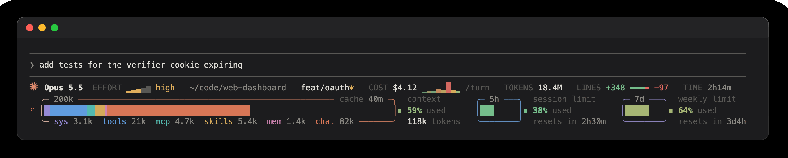
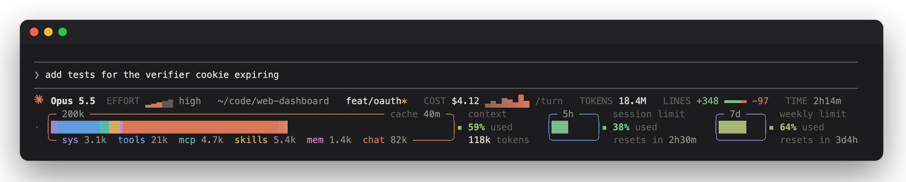
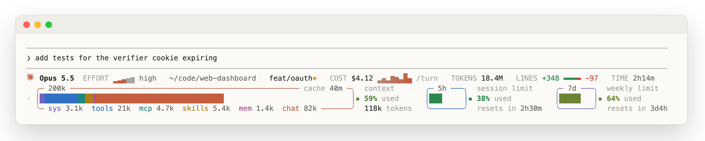

# claude-statusline

**A calm, information-dense status line for Claude Code: context as a battery, limits with reset timers, and a little motion while Claude works.**



| dark | light |
|---|---|
|  |  |

<sub>Screenshots are real output rendered from generated demo data (`scripts/demo.py`).</sub>

## What you see

**Line 1: the session**

| item | meaning |
|---|---|
| logo + model | the Claude mark and the current model. While Claude works, the mark breathes. |
| `EFFORT ▂▃▄▅▆ high` | the reasoning effort. Five rising bars stand for low → max; the lit ones are the current level. |
| directory, `branch*` | the working folder and git branch. `*` means uncommitted changes; `↑n ↓n` means ahead of or behind upstream. |
| `COST $4.12 ▃▅▃▇… /turn` | total session cost, followed by the cost of each of the last 8 turns. A new bar grows in when a turn ends. |
| `TOKENS 18.4M` | every token processed this session: input, output, cache reads and cache writes, subagents included |
| `LINES +348 ▬▬ −97` | lines Claude added and removed through its edit tools, with the ratio as a small bar |
| `TIME 2h14m` | session duration |

**Lines 2–4: three batteries**

| battery | contents |
|---|---|
| context, titled with the window size (`200k`, `1M`) | <ul><li>A stacked bar shows what fills the context: `sys` system prompt, `tools`, `mcp`, `skills`, `mem` (CLAUDE.md + auto memory) and `chat`.</li><li>The bottom edge lists the token count for each part.</li><li>The top edge counts down to prompt-cache expiry; it turns amber under 5 minutes.</li><li>On the right: % used and tokens in context.</li></ul> |
| `5h` session limit | % used and time until it resets |
| `7d` weekly limit | % used and time until it resets |

**Colours and motion**
- The `▪` tip at the right of each battery goes green → amber → red as usage climbs.
- Each battery has its own frame colour: orange for context, blue for 5h, purple for 7d.
- While Claude is working, a spinner turns and a light sweeps along the frames. When idle, only a faint, slow shimmer remains.

**Narrow terminals.** The layout reads the live terminal width every refresh and hides parts in priority order: the 7d battery first, then the context legend. It never wraps.

## Install

```sh
git clone https://github.com/PixelCookie-zyf/claude-statusline.git
cd claude-statusline
./install.sh --configure      # links the script, installs the logo font, adds statusLine to settings.json
```

Then restart Claude Code, or run `/restart`.

- Without `--configure`, the script prints the snippet for you to add yourself:

  ```json
  "statusLine": {
    "type": "command",
    "command": "python3 -I -S ~/.claude/statusline/statusline.py",
    "padding": 0,
    "refreshInterval": 1
  }
  ```

  `refreshInterval: 1` keeps the timers and the idle shimmer moving. Drop it if you only want updates on events.
- `--no-font` skips the ClaudeMark font. The logo then falls back to `✻`.

**Requirements**
- Python 3.8+ (standard library only).
- A truecolor terminal.
- A Claude Code version that sends `effort`, `context_window`, `rate_limits` and `prompt_cache` in the statusline JSON. Developed against 2.1.319; missing fields are simply not shown.
- Built on macOS. The live terminal width uses `ps` and `ioctl` and should work on Linux. The `auto` theme reads the macOS appearance setting.

## Configure

The constants at the top of `statusline.py` are meant to be edited. Changes apply on the next refresh.

| constant | default | effect |
|---|---|---|
| `CLAUDE_ICON` | `None` (auto) | `"✻"` forces the asterisk; `""` hides the logo |
| `GAP_AFTER_ICON` | two spaces | space between the logo and the model name |
| `FRAME_COLORS` | `True` | `False` gives neutral grey battery frames |
| `FRAME_TINT` | `0.75` | how strongly the frames take their colour (0–1) |
| `IDLE_SHIMMER` | `True` | the faint shimmer while idle |
| `SPARK_LEN` | `8` | turns shown in the cost sparkline |
| `BUSY_WINDOW` | `3.0` | how many seconds after the last transcript write still count as "working" |
| `PALETTES` | — | the dark and light colour sets |

The theme follows Claude Code's `/theme`. For `auto`, it follows the macOS appearance.

## How it works

- **Statusline JSON.** Claude Code pipes it to the script on every update, and once per second with `refreshInterval`. Model, effort, cost, lines, context usage, limits and prompt-cache expiry all come straight from it.
- **Context breakdown.** These are estimates. The script reads the session transcript incrementally and sizes its parts at about 3.7 characters per token:
  - the request shape: system prompt, built-in tools and `mcp__*` tools;
  - the skill, agent and MCP listings;
  - your CLAUDE.md files and `MEMORY.md`.

  Whatever remains of the real total is counted as `chat`.
- **TOKENS.** The cumulative per-model usage Claude Code records in the transcript (`cost-state`).
- **Width.** `$COLUMNS` is frozen when Claude Code starts, so the script asks Claude's own tty for its size each time. That lets the layout follow window resizes.
- **Cost.** Each run takes about 20 ms. State such as the sparkline history and scan offsets lives in `~/.claude/statusline/cache/`. The latest input is also saved as `last-input.json` there, which helps with debugging.

The transcript format is internal to Claude Code and may change. If something looks off after an update, please open an issue.

## Demo and screenshots

```sh
python3 scripts/demo.py /tmp/sl-demo                  # render once from fake data
python3 scripts/demo.py /tmp/sl-demo --busy --theme light
python3 scripts/screenshot.py docs/dark.png --theme dark          # needs Google Chrome
python3 scripts/screenshot.py docs/working.gif --theme dark --gif # also needs Pillow
```

The demo builds a throwaway `$HOME` with a fake transcript, git repo and settings, so your real `~/.claude` is never touched.

## See also

[claude-sessions](https://github.com/PixelCookie-zyf/claude-sessions): browse, preview and resume Claude Code sessions with fzf.

## Credits

- The logo glyph comes from [Bootstrap Icons](https://icons.getbootstrap.com/icons/claude/) (MIT). It is repackaged as a one-glyph font at U+10F914; see `fonts/LICENSE-bootstrap-icons`.
- Claude and the Claude logo are trademarks of Anthropic. This project is not affiliated with or endorsed by Anthropic.

## License

[MIT](LICENSE)
